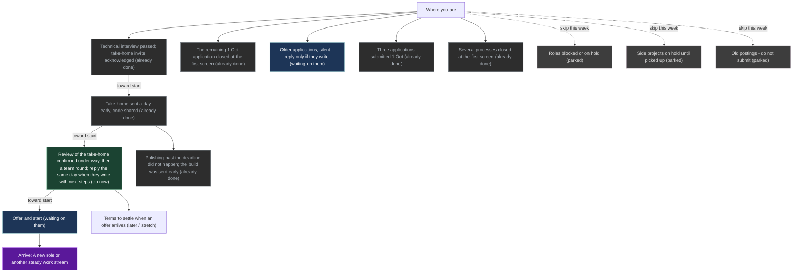

# Mission heading

Nightly rewrite (20:00 local). Numbers from `mission-map-graph`. No silent a/m/b overwrite.

**Do this now:** Review of the take-home confirmed under way, then a team round; reply the same day when they write with next steps

Review of the take-home confirmed under way, then a team round; reply the same day when they write with next steps. check-in answered; reply the same day on next steps; no further nudge. Also: Older applications, silent - reply only if they write — no nudge.

**Updated:** 2026-10-18T20:10:01+0200  
**On the path?** **on-path**

| | |
|--|--|
| **Arrive when** | A new role or another steady work stream |
| **Do this now** | Review of the take-home confirmed under way, then a team round; reply the same day when they write with next steps |
| **Live thread (intro already happened)** | 3.22 weeks typical |
| **If that thread dies** | you usually know within ~1 week of silence — not 12 weeks |
| **Longest remaining chain** | 3.216667 weeks (kernel; not a destiny date) |
| **Change since last snapshot** | 0.000000 |
| **This tick alignment** | 1.0 |
| **This tick did** | Evening check: no new reply on the live process; one fresh application confirmed; nothing on the calendar |
| **Named Do (still)** | Reply the same day when they write with next steps; no further nudge |

This week's act is on the path to a start date.

## How to push

Reply the same day when a live process writes with next steps. Do not chase after about a week of silence. A short check-in was answered; the take-home is confirmed in review — wait for next steps, no further nudge. Submit fresh postings the same week they appear.

## How long (Sweden rounds)

The take-home for the live process was sent a day early; a check-in confirmed the team has it and review is under way (day 10). Wait for next steps; no further nudge. Several older applications are silent and are treated as closed unless they write. Swedish processes usually take 1-3 weeks per round; a start can be 1-4 weeks after an offer. One fresh application went in this week; it waits for a reply.

## Stages

Plain language. No S0/S1 codes. Emails are local-only.

| What | Status | Next follow-up | When |
|------|--------|----------------|------|
| Technical interview passed; take-home invite acknowledged | already done | done | this week |
| Take-home sent a day early, code shared | already done | done | this week |
| Review of the take-home confirmed under way, then a team round; reply the same day when they write with next steps | do now | check-in answered; reply the same day on next steps; no further nudge | — |
| Offer and start | waiting on them | — | — |
| The remaining 1 Oct application closed at the first screen | already done | done | this week |
| Older applications, silent - reply only if they write | waiting on them | no nudge | — |
| Terms to settle when an offer arrives | later / stretch | — | — |
| Polishing past the deadline did not happen; the build was sent early | already done | — | — |
| Three applications submitted 1 Oct | already done | — | — |
| Several processes closed at the first screen | already done | — | — |
| Roles blocked or on hold | parked | — | — |
| Side projects on hold until picked up | parked | — | — |
| Old postings - do not submit | parked | — | — |

## Graph

LLM may propose a stage. Human confirms. Do not treat this page as a destiny date.
