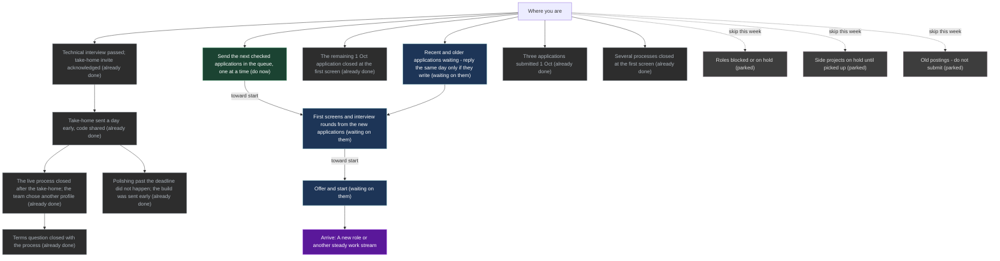

# Mission heading

Nightly rewrite (20:00 local). Numbers from `mission-map-graph`. No silent a/m/b overwrite.

**Do this now:** Send the next checked applications in the queue, one at a time

Send the next checked applications in the queue, one at a time. queue open. Also: Recent and older applications waiting - reply the same day only if they write — no nudge.

**Updated:** 2026-10-30T20:12:14+0100  
**On the path?** **on-path**

| | |
|--|--|
| **Arrive when** | A new role or another steady work stream |
| **Do this now** | Send the next checked applications in the queue, one at a time |
| **Live thread (intro already happened)** | 2.17 weeks typical |
| **If that thread dies** | you usually know within ~1 week of silence — not 12 weeks |
| **Longest remaining chain** | 5.455000 weeks (kernel; not a destiny date) |
| **Change since last snapshot** | 0.000000 |
| **This tick alignment** | 1.0 |
| **This tick did** | Evening check: no new applications today; three earlier ones closed |
| **Named Do (still)** | Give one short yes, then send the three ready applications one at a time |

This week's act is on the path to a start date.

## How to push

Reply the same day when a live process writes with next steps. Do not chase after about a week of silence. With no live process, send the ready applications this week, one at a time, before preparing any new ones.

## How long (Sweden rounds)

No applications went out today; three earlier ones closed at the first screen. Three checked applications wait only on one short yes, then go out one at a time. Swedish processes usually take 1-3 weeks per round; a start can be 1-4 weeks after an offer.

## Stages

Plain language. No S0/S1 codes. Emails are local-only.

| What | Status | Next follow-up | When |
|------|--------|----------------|------|
| Technical interview passed; take-home invite acknowledged | already done | done | this week |
| Take-home sent a day early, code shared | already done | done | this week |
| The live process closed after the take-home; the team chose another profile | already done | done | this week |
| Send the next checked applications in the queue, one at a time | do now | queue open | — |
| First screens and interview rounds from the new applications | waiting on them | — | — |
| Offer and start | waiting on them | — | — |
| The remaining 1 Oct application closed at the first screen | already done | done | this week |
| Recent and older applications waiting - reply the same day only if they write | waiting on them | no nudge | — |
| Terms question closed with the process | already done | — | — |
| Polishing past the deadline did not happen; the build was sent early | already done | — | — |
| Three applications submitted 1 Oct | already done | — | — |
| Several processes closed at the first screen | already done | — | — |
| Roles blocked or on hold | parked | — | — |
| Side projects on hold until picked up | parked | — | — |
| Old postings - do not submit | parked | — | — |

## Graph

LLM may propose a stage. Human confirms. Do not treat this page as a destiny date.
